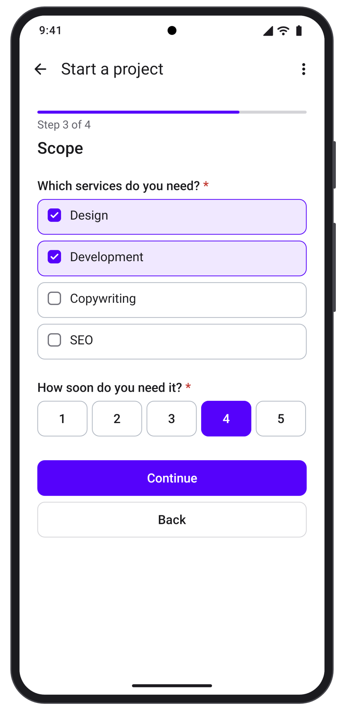
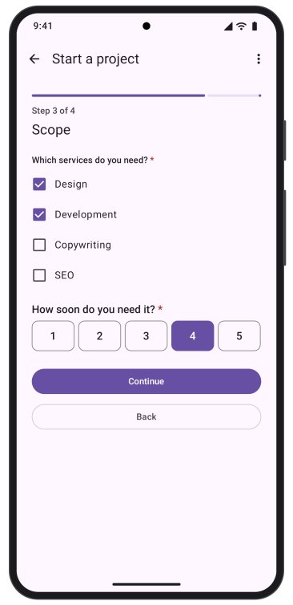
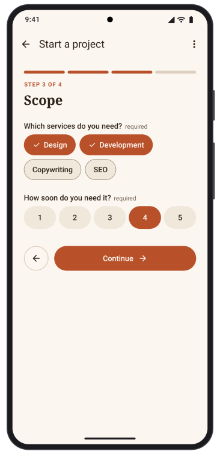

<p align="center">
  
</p>

<p align="center">
  <a href="https://github.com/formhaus-dev/formhaus-kotlin/actions/workflows/ci.yml"></a>
  <a href="https://central.sonatype.com/namespace/dev.formhaus"></a>
  
  
  
  <a href="LICENSE"></a>
</p>

<p align="center">
  Kotlin engine and Jetpack Compose renderer for <a href="https://github.com/formhaus-dev/formhaus">Formhaus</a> JSON form definitions.
</p>

<p align="center">
  <a href="https://formhaus.dev/guide/android">Documentation</a> ·
  <a href="https://formhaus.dev/playground">Playground</a>
</p>

## Install

Releases are published to Maven Central:

```kotlin
dependencies {
    implementation("dev.formhaus:formhaus-core:0.4.0")
    implementation("dev.formhaus:formhaus-compose:0.4.0")
}
```

| Package | Contents |
|---|---|
| `formhaus-core` | Engine, validation, `validateSubmission`. Pure Kotlin for the JVM and Android. |
| `formhaus-compose` | Jetpack Compose renderer. Android library, depends on `formhaus-core`. |
| `formhaus-research` | Option order for `randomize` fields. Pure Kotlin, depends on `formhaus-core`. |

`formhaus-core` has one dependency, `kotlinx-coroutines-core`, and no Android or Compose artifacts, so it also runs on a server. There is no JavaScript runtime.

To work from a local clone, run `./gradlew publishToMavenLocal` and add `mavenLocal()` to your repositories.

## Requirements

- JDK 17 or later.
- Android: `minSdk` 26 or later. `formhaus-compose` is built with `compileSdk` 37.

The libraries are built with Kotlin 2.4. `formhaus-core` and `formhaus-research` call only APIs that exist on Android API 26, and `./gradlew check` verifies this.

## Quick start with Compose

Parse a definition and render it. The submit handler returns `SubmitResult.Ok`, or `SubmitResult.Rejected` with errors that the form shows on the fields:

```kotlin
import androidx.compose.runtime.Composable
import dev.formhaus.compose.form.FormhausForm
import dev.formhaus.core.engine.SubmitResult
import dev.formhaus.core.json.JsonValue
import dev.formhaus.core.json.toJsonString
import dev.formhaus.core.model.FormDefinition
import kotlinx.coroutines.Dispatchers
import kotlinx.coroutines.withContext

val definition = FormDefinition(JsonValue.parse(assets.open("signup.json").readBytes()))

@Composable
fun SignupScreen() {
    FormhausForm(definition) { values, _ ->
        val response = withContext(Dispatchers.IO) { api.post("https://example.com/signup", values.toJsonString()) }
        SubmitResult.of(JsonValue.parse(response))
    }
}
```

The submit handler runs on the main thread and returns a `SubmitResult?`. `SubmitResult.of(json)` reads the `{ ok, errors, formErrors }` object that a Formhaus endpoint returns. `FormhausForm` takes `initialValues`, `engineOptions` and `renderer` options. `FormhausFormContent(model)` renders the form without its own scroll container.

`FormhausForm(definition)` keeps its values, step and picked files when the activity is recreated, for example on rotation or a dark mode switch, and restores them after process death. It keeps them in a `ViewModel` of the nearest `ViewModelStoreOwner`, so a form that leaves the composition and comes back, such as a `LazyColumn` item, a tab or a screen in the back stack, shows the same state. The state is released when that owner is cleared. Without an owner, the form releases its state when it leaves the composition. A submit that is already sending runs to the end. Progress over 96 KB, counted as UTF-16, is not saved for process death and reports a `snapshot-too-large` warning. Password values are never saved.

Options with an `image` load the picture over the network, so the app needs the `android.permission.INTERNET` permission.

### Keep a model in a ViewModel

For a form whose state lives outside the composable, create a `FormModel` and pass it to `FormhausForm(model)`. A model you create is yours to close. `close()` stops its work and deletes the files picked in it:

```kotlin
import androidx.lifecycle.ViewModel
import dev.formhaus.compose.model.FormModel

class SignupViewModel : ViewModel() {
    val form = FormModel(definition) { values, _ -> send(values) }

    override fun onCleared() {
        form.close()
    }
}
```

### Saving progress

`onSnapshotChange` receives a `FormSnapshot` after the values, the step or the skipped steps change, at most once per frame, and `null` once a submit succeeds. Store `snapshot.toJson()` and pass it back as `restoring` to continue where the respondent left off:

```kotlin
FormhausForm(
    definition,
    restoring = saved?.let(FormSnapshot::fromJson),
    onSnapshotChange = { snapshot -> store(snapshot?.toJson()) },
) { values, _ -> send(values) }
```

A snapshot restores the values, the current step, the skipped steps and the option order seed without running validation. A snapshot of another form or another snapshot version, or one whose step no longer exists, starts the form fresh and reports a `snapshot-mismatch` warning. `restoring` replaces `initialValues` and takes precedence over the state `FormhausForm` saved for process death. A snapshot leaves out the values of `password` fields, so they are empty after a restore. `FormModel` takes the same two parameters, and `FormEngine` takes `restoring` and has `snapshot()`.

## Quick start without a UI

`FormEngine` runs the same form without a UI, for a renderer of your own or a server. `next`, `back`, `skip` and `submit` are `suspend` functions, because hooks and the submit handler can wait on the network:

```kotlin
import dev.formhaus.core.engine.FormEngine
import dev.formhaus.core.engine.SubmitResult
import dev.formhaus.core.json.JsonValue
import dev.formhaus.core.json.toJsonString

val definition = JsonValue.parse(
    """
    {
      "id": "signup",
      "submit": { "label": "Sign up" },
      "steps": [
        { "id": "account", "fields": [
          { "key": "email", "type": "email", "label": "Email", "validation": { "required": true } }
        ] },
        { "id": "profile", "fields": [
          { "key": "name", "type": "text", "label": "Name" }
        ] }
      ]
    }
    """,
)

val engine = FormEngine(definition)
engine.setValue("email", JsonValue.String("ada@example.com"))

suspend fun fill() {
    if (engine.next()) {
        engine.setValue("name", JsonValue.String("Ada"))
        engine.submit { values, _ ->
            send(values.toJsonString())
            SubmitResult.Ok
        }
    }
}
```

`next` returns `false` when validation fails, and the errors are in `engine.errors`. The submit handler receives the values of the active path and the ids of skipped steps. Observe the engine with `engine.subscribe { ... }`, which returns a function that removes the listener. Read `engine.currentStep`, `engine.visibleFields`, `engine.errors`, `engine.topLevelErrors`, `engine.progress` and `engine.canGoNext` after each change. The [documentation](https://formhaus.dev/guide/) covers the definition format.

## Randomize options

A `radio`, `multiselect` or `select` field with `"randomize": true` shows its options in a random order per respondent. Add `formhaus-research` and pass `Research()`:

```kotlin
implementation("dev.formhaus:formhaus-research:0.4.0")
```

```kotlin
import dev.formhaus.core.engine.FormEngineOptions
import dev.formhaus.research.Research

FormhausForm(definition, engineOptions = FormEngineOptions(research = Research())) { values, _ ->
    send(values)
    SubmitResult.Ok
}
```

Without it, options show in written order and the engine reports `missing-research` through `onWarning`. The same `seed` in `FormEngineOptions` shows the same order again.

## Choose a look

The same form in the three sets:

| Formhaus | Material | Your own |
|:---:|:---:|:---:|
|  |  |  |

### The Formhaus set

The default, `FormComponents.standard`. It matches the web renderers of `@formhaus/react` and `@formhaus/vue`, and uses the Formhaus design tokens.

### Material 3

`FormComponents.system` renders the form with Material 3 components and takes its colors from the `MaterialTheme` around it:

```kotlin
import androidx.compose.runtime.CompositionLocalProvider
import dev.formhaus.compose.form.FormComponents
import dev.formhaus.compose.form.LocalFormComponents

MaterialTheme {
    CompositionLocalProvider(LocalFormComponents provides FormComponents.system) {
        FormhausForm(definition) { _, _ -> SubmitResult.Ok }
    }
}
```

`LocalFormBehavior` takes a `FormBehavior` for the error summary, the remove confirmation, the Back button placement, step scrolling and the title display mode. With `BackPlacement.APP_BAR` the form leaves its Back button out, so your app bar shows Back while `model.actions.showBack` is true and calls `model.back()`.

### Your own components

Register a composable per field type on top of a built-in set. Types you leave out keep the built-in views:

```kotlin
val brand = FormComponents.standard
    .field("text") { UnderlineField(it) }
    .field("email") { UnderlineField(it) }

@Composable
fun UnderlineField(context: FieldContext) {
    val requester = remember { FocusRequester() }
    FieldShell(context) {
        BasicTextField(
            value = context.text,
            onValueChange = { context.setValue(JsonValue.String(it)) },
            modifier = Modifier.fillMaxWidth().formhausFocus(context, requester),
        )
    }
}
```

`FieldShell` draws the label, helper text and error, and lets the form scroll to the field. `formhausFocus` joins focus to the first error. `section`, `group`, `groupItem`, `confirmDialog`, `progress` and `actions` replace the containers. `FormComponents.headless` has no built-in fields, so every type comes from your registrations. The demo app has a complete custom field in [`demo/src/main/kotlin/dev/formhaus/demo/UnderlineField.kt`](demo/src/main/kotlin/dev/formhaus/demo/UnderlineField.kt), and a whole brand set, Kiln, with its own fields, step header, sections and actions in [`demo/src/main/kotlin/dev/formhaus/demo/kiln`](demo/src/main/kotlin/dev/formhaus/demo/kiln).

Switching the components or the theme of a running form keeps its values, step and errors.

## Theming

`FormhausTheme` holds the [Formhaus design tokens](https://github.com/formhaus-dev/formhaus/tree/main/packages/core/tokens): light and dark palettes, type sizes, spacing, radii, control sizes and motion. `FormhausTheme.standard` is the touch theme.

```kotlin
import androidx.compose.ui.graphics.Color
import androidx.compose.ui.unit.dp
import dev.formhaus.compose.theme.FormhausTheme
import dev.formhaus.compose.theme.Palette

val brand = FormhausTheme.standard.copy(
    light = Palette.light.copy(primary = Color(0xFFB84F29)),
    dark = Palette.dark.copy(primary = Color(0xFFE88259)),
    radii = FormhausTheme.standard.radii.copy(control = 22.dp),
)

FormhausTheme(brand) {
    FormhausForm(definition) { _, _ -> SubmitResult.Ok }
}
```

Custom components read the resolved tokens from `LocalFormhausTokens.current` and style text with `tokens.textStyle(TextRole.body)`. When the system contrast setting is raised, on Android 14 and later, the built-in palettes switch to the `contrast: more` values of the tokens. Set `lightIncreased` and `darkIncreased` to choose those colors yourself.

## UI tests

Set `testIds` to tag the form for Compose UI tests. They are off by default:

```kotlin
FormhausForm(definition, renderer = FormRendererOptions(testIds = TestIds.Automatic)) { _, _ -> SubmitResult.Ok }
```

`TestIds.Automatic` names each element after the definition `id` with the scheme of the web `testIds`: `<id>.form`, `<id>.<key>`, `<id>.<key>.<value>`, `<id>.<group>.<index>.<key>`, `<id>.submit`, `<id>.next`, `<id>.back` and `<id>.summary`. The tags are `Modifier.testTag` values:

```kotlin
compose.onNodeWithTag("signup.email").assertExists()
compose.onNodeWithTag("signup.next").performClick()
```

A field tag sits on the field row, which holds the label, the control and the error. `TestIds.Custom { target -> ... }` names the tags yourself from a `TestIdTarget`. Custom field composables read `context.testId` and `context.optionTestId(value)`.

## Validate on the server

`validateSubmission` checks the values against the same definition, with the visibility, steps and routes of the client:

```kotlin
import dev.formhaus.core.json.JsonValue
import dev.formhaus.core.server.SubmissionOptions
import dev.formhaus.core.server.validateSubmission

val result = validateSubmission(
    definition,
    JsonValue.parse(requestBody),
    SubmissionOptions(skippedSteps = listOf("profile")),
)
if (result.errors.isEmpty()) {
    save(result.values)
} else {
    reject(result.errors)
}
```

The body is the values object. `result.values` holds the values of the active path, and `result.errors` maps keys to messages. `SubmissionOptions` also takes custom `validators`, `messages` and `hiddenValues`. `checkDefinition(definition)` lists the issues of a definition before you use it:

```kotlin
import dev.formhaus.core.definitionvalidation.checkDefinition

val problems = checkDefinition(definition).filter { it.isError }
```

## Translations

`localize` applies an overlay of translated texts and sets the language. `missingKeys` lists the built-in message and label keys that a catalog lacks, for a unit test of your translations:

```kotlin
import dev.formhaus.core.engine.FormEngine
import dev.formhaus.core.engine.FormEngineOptions
import dev.formhaus.core.i18n.localize
import dev.formhaus.core.i18n.missingKeys
import dev.formhaus.core.validation.MessageSource

val overlay = JsonValue.parse("""{ "fields": { "email": { "label": "E-Mail" } }, "submit": { "label": "Anmelden" } }""")
val localized = localize(definition, overlay, "de")

val engine = FormEngine(
    localized.definition,
    options = FormEngineOptions(messages = MessageSource.Catalog(localized.messages)),
)
val missing = missingKeys(messages = MessageSource.Catalog(localized.messages))
println(missing.messages)
```

`Localized` holds the translated `definition` and the `messages` and `labels` catalogs. With `debugChecks` on and a `messages` catalog in `FormEngineOptions`, the engine reports `missing-message-key` through `onWarning` when a shown message is in neither the catalog nor the definition.

Field texts live at `fields.<key>` of the overlay. In a multi-step form they can also live at `steps.<id>.fields.<key>`, which wins when both are set.

### Languages

`formhaus-core` ships message and label catalogs for `es`, `fr`, `fr-CA`, `de`, `pt-BR`, `it`, `ja`, `zh-CN`, `ru` and `uk`, plus `en`. Pass them as `locale`:

```kotlin
import dev.formhaus.core.i18n.LocaleCatalog
import dev.formhaus.core.i18n.localeChain
import java.util.Locale

val catalogs = localeChain(Locale.getDefault().toLanguageTag()).mapNotNull(LocaleCatalog::bundled)

FormhausForm(definition, engineOptions = FormEngineOptions(locale = catalogs)) { values, _ -> send(values) }
```

`localeChain(tag)` lists the tags to try, from the most specific one to `en`, and adds the likely region, so `zh-Hans-CN` also tries `zh-CN` and `pt` tries `pt-BR`. It drops `-u-` and `-x-` extensions, so `de-DE-u-fw-mon` tries `de-DE` and `de`. `engine.locale = catalogs` switches a running engine, and `FormhausForm` picks up a new `locale` in `engineOptions`. For each key, `messages` in `FormEngineOptions` and `labels` in `FormRendererOptions` win over the `messages` and `labels` of the definition, which win over the catalogs in list order, which win over the built-in English.

A catalog text can be `PluralForms`, picked by the CLDR plural rules of the catalog locale on `{count}`, `{min}` or `{max}`. That number is formatted for the same locale. Plural rules cover the languages of the bundled catalogs and `pt-PT`; other languages use `other`.

```kotlin
import dev.formhaus.core.i18n.PluralForms
import dev.formhaus.core.validation.MessageKey

val minLength =
    PluralForms(
        other = "Не менее {min} символа",
        one = "Не менее {min} символа",
        few = "Не менее {min} символов",
        many = "Не менее {min} символов",
    )
val ru = LocaleCatalog("ru", messages = mapOf(MessageKey.MIN_LENGTH to minLength))
```

`LocaleCatalog.fromJson(json)` reads a catalog in the format of `@formhaus/core/locales/<tag>.json`, and `checkCatalog(json)` lists its missing and unknown keys.

## Errors

`errorSummary()` returns the field errors grouped by step, the top-level errors and the field error count:

```kotlin
import dev.formhaus.core.renderer.errorSummary

val summary = engine.errorSummary()
val first = summary.groups.firstOrNull()?.entries?.firstOrNull()
```

Each entry has the field `key`, its `text` with the field label, and an `id` with the scheme of the web renderers. `ErrorSummaryOptions` takes an `idPrefix` and `labels`.

## FormEngineOptions

| Option | Effect |
|---|---|
| `seed` | Fixes the random option order of `randomize` fields. The same seed gives the same order. |
| `research` | A `FormResearch` that creates seeds and orders options. `Research()` from `formhaus-research` is the built-in one. Without it, options show in written order. |
| `hiddenValues` | `HiddenValues.CLEAR` (default) drops the value of a field that a condition hides. `HiddenValues.KEEP` keeps it in `engine.values` and in submitted values. |
| `debugChecks` | Makes calls from a thread other than the creating one throw, and reports missing message keys. With `FormhausForm(definition)`, `null`, the default, turns the checks on when the app is debuggable. |
| `recallFormatter` | A `RecallFormatter` that formats recalled answers: lists, numbers, dates and times. The default follows CLDR 48. |
| `locale` | `LocaleCatalog`s that translate messages and labels, in order. See [Languages](#languages). |
| `onValidate` | Runs after the definition rules pass, on Continue after `onStepValidate` and on Submit before `onBeforeSubmit`. Returns errors keyed by field path. |

The options class also takes `onBeforeStepChange`, `onAfterStepChange`, `onBeforeSubmit`, `onAfterSubmit`, `onStepValidate`, `onFormEvent`, `onWarning`, `validators`, `messages`, `lang` and `formatRecall`.

```kotlin
import dev.formhaus.core.engine.FormEngineOptions
import dev.formhaus.core.engine.HiddenValues
import dev.formhaus.research.Research

val engine = FormEngine(
    definition,
    options = FormEngineOptions(
        research = Research(),
        seed = "respondent-42",
        hiddenValues = HiddenValues.KEEP,
        debugChecks = true,
    ),
)
val order = engine.orderOptions("plan").map { it.value }
```

`onValidate` gets the values and a `ValidateContext` with `stepId`, `fields`, the visible field paths in scope, and `submit`. Keys outside `fields` show as top-level errors, and an error on another step opens that step on Submit:

```kotlin
val engine = FormEngine(
    definition,
    options = FormEngineOptions(
        onValidate = { values, context ->
            if ("email" in context.fields && api.isTaken(values["email"])) stringMapOf("email" to "Taken") else null
        },
    ),
)
```

Top-level errors from `onStepValidate` and `onValidate` clear on the next Continue, Back, Skip or Submit. Errors from the submit handler and `setErrors` stay.

With `HiddenValues.KEEP`, conditions, validation and recall still treat hidden fields as unanswered, so they never block `next` or `submit`. Pass `SubmissionOptions(hiddenValues = HiddenValues.KEEP)` to `validateSubmission` as well, or the server drops them.

## Threading

`FormEngine` is single-threaded. Create it and call it from one thread, such as the main thread, and do not share it. With `debugChecks = true`, a call from another thread throws `IllegalStateException` with both thread names. `FormhausForm(definition)` turns the checks on in a debuggable app unless `debugChecks` is `false`, so an engine call from a background thread throws there. A `FormModel` you create keeps them off unless you set `debugChecks = true`. `validateSubmission`, `checkDefinition`, `localize` and the JSON parser can run on any thread, also at the same time.

## Compatibility

| formhaus-kotlin | @formhaus/core | Format |
|---|---|---|
| 0.4.0 | 1.3.0 | 1.6 |
| 0.3.0 | 1.3.0 | 1.6 |
| 0.2.1 | 1.2.2 | 1.6 |
| 0.2.0 | 1.2.2 | 1.6 |
| 0.1.0 | 1.2.2 | 1.6 |

## Conformance

Behaviour follows the [conformance suite](https://github.com/formhaus-dev/formhaus/tree/main/packages/core/fixtures/conformance) of `@formhaus/core`. The pinned core ref is recorded in `formhaus-core/src/test/resources/fixtures/VERSION`. Definition files, value cases, recall cases, option order vectors and every engine scenario run as tests.

To move to another release:

```sh
./scripts/sync-fixtures.sh @formhaus/core@X.Y.Z
```

The fixtures are copied, never edited here. See [CONTRIBUTING.md](CONTRIBUTING.md).

## Unicode and CLDR data

Case folding, Unicode properties and the formats for recalled lists, numbers and dates come from embedded tables of Unicode 17 and CLDR 48, not from the JDK or Android. Results are the same on every JVM, and on every Android version from API 26. The tables are generated by `scripts/unicode-tables.mjs` and `scripts/cldr-tables.mjs`.

## Performance

Patterns run on a native ECMAScript 2025 regex engine, so a pattern matches the same values as in the browser. Patterns without backreferences match in time linear in the input, and every match has a step budget, so no pattern can hang the app.

- An email pattern check takes 59 ns.
- A form with 3,000 picture options renders in 16 ms, and a selection takes 2.6 ms.
- Typing one character into a text field takes 6.5 ms, including layout and drawing.

Measured on an Apple M5 Pro with JDK 17. Run `scripts/benchmarks.sh` for the full set.

## Demo app

`demo` is an Android app with a list of sample forms: a three-step "Start a project" form with pictures, a matrix and a scale, a contact form, a three-step trip form with a group of travellers and randomized options, the contact form in German, the trip form in the Material 3 set, and the contact form with a custom text field. The menu in the top bar switches a form between the Formhaus, Material 3 and Kiln looks. Build it with:

```sh
./gradlew :demo:assembleDebug
```

## Contributing

See [CONTRIBUTING.md](CONTRIBUTING.md). Behaviour changes start in the [Formhaus](https://github.com/formhaus-dev/formhaus) repository.

## Security

Report vulnerabilities privately. See [SECURITY.md](SECURITY.md).

## License

[MIT](LICENSE)
